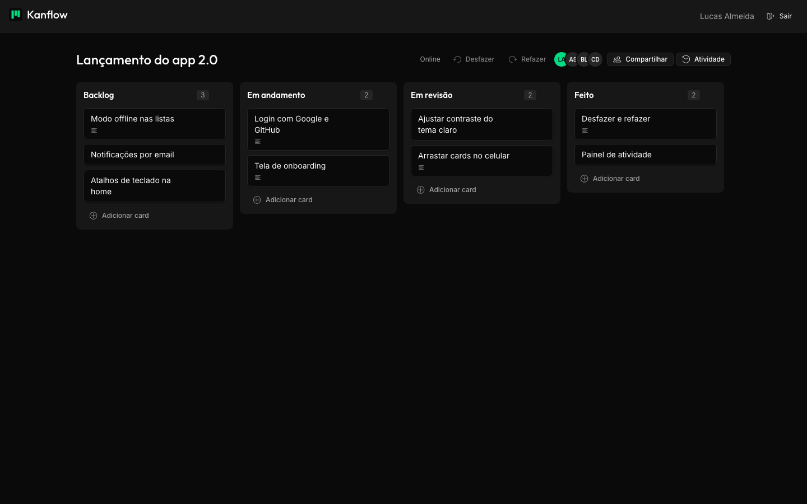
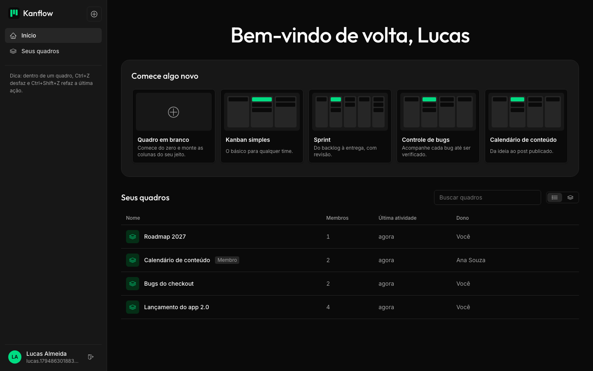
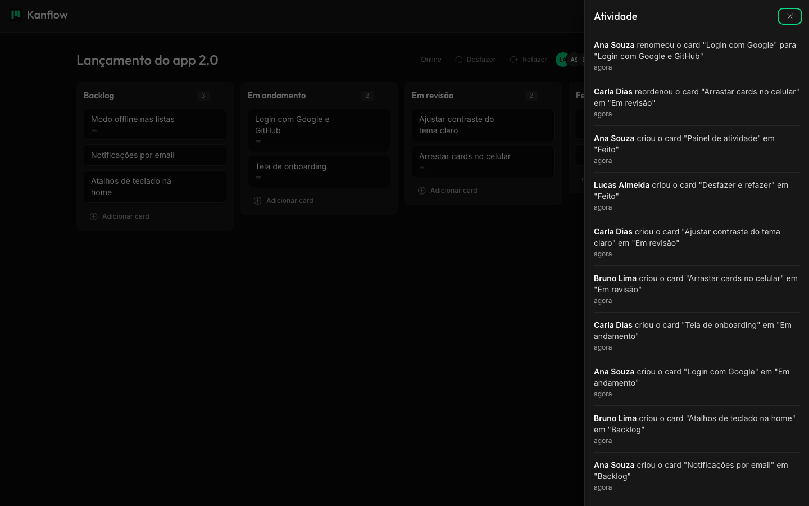
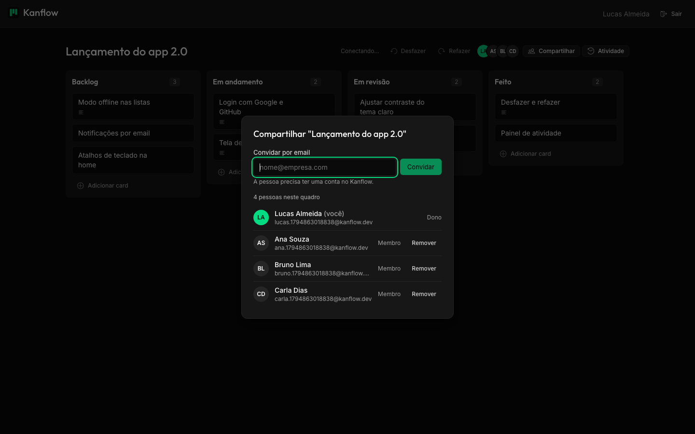
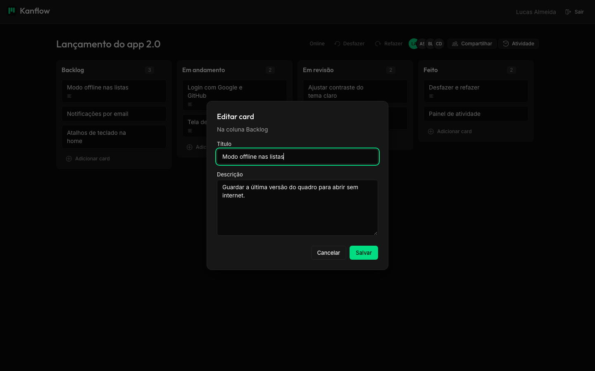
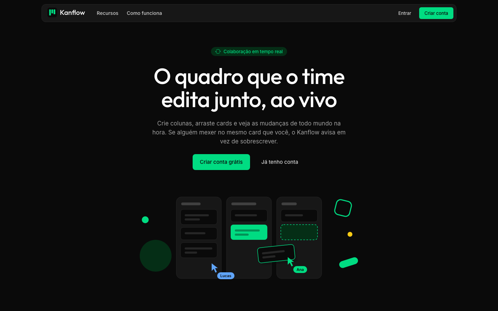
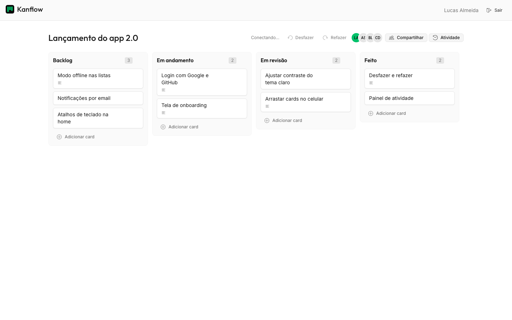
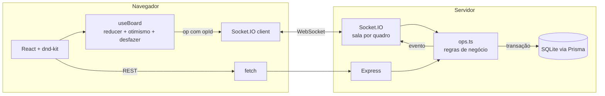
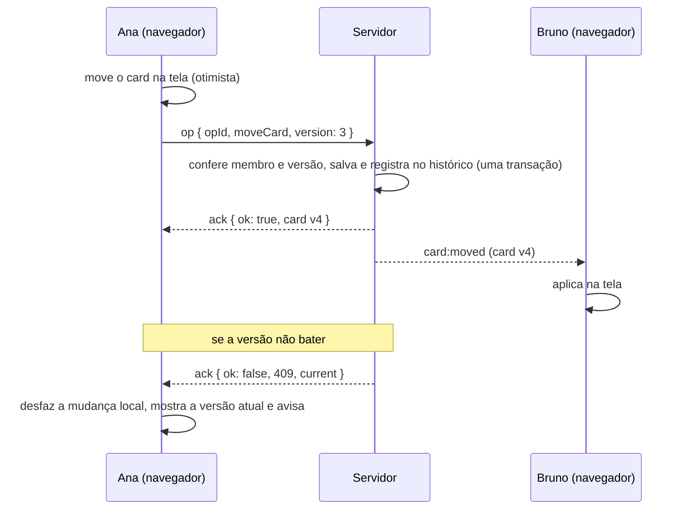

<p align="center">
  
</p>

<h1 align="center">Kanflow</h1>

<p align="center">
  Quadros kanban colaborativos em tempo real, com arrastar e soltar, atualizações otimistas e desfazer/refazer.
</p>

<p align="center">
  <a href="https://github.com/LucasAlmeida-jpg/Kanflow/actions/workflows/ci.yml"></a>
  
  
  
  
</p>



O Kanflow é um projeto de portfólio no estilo Trello/Linear simplificado. O foco não é ter muitas funcionalidades, e sim resolver bem os problemas difíceis de uma ferramenta colaborativa: **várias pessoas editando o mesmo quadro ao mesmo tempo**, **interface que responde na hora** mesmo antes do servidor confirmar, e **nunca sobrescrever o trabalho de outra pessoa sem avisar**.

## Funcionalidades

- **Arrastar e soltar** cards dentro da coluna e entre colunas, com prévia do lugar e suporte a teclado e leitor de tela.
- **Tempo real**: quem está no quadro vê cada card criado, movido, editado ou apagado no mesmo instante.
- **Atualizações otimistas com rollback**: a tela muda na hora e volta ao estado anterior se o servidor recusar.
- **Conflitos tratados**: se duas pessoas mexem no mesmo card, a segunda recebe a versão mais nova e um aviso, em vez de apagar a mudança da primeira.
- **Desfazer e refazer** (Ctrl+Z / Ctrl+Shift+Z) de criar, editar, mover e apagar cards.
- **Histórico de atividade**: quem fez o quê e quando.
- **Membros**: convidar por email, remover e sair do quadro. Quem é removido perde o acesso na hora, inclusive com o quadro aberto.
- **Modelos de quadro** (Sprint, Controle de bugs, Kanban simples...) que já criam as colunas.
- **Tema claro e escuro**, design system próprio e layout responsivo.

<table>
  <tr>
    <td width="50%"><p align="center"><sub>Home com modelos e a lista de quadros</sub></p></td>
    <td width="50%"><p align="center"><sub>Histórico de atividade</sub></p></td>
  </tr>
  <tr>
    <td width="50%"><p align="center"><sub>Convidar e remover membros</sub></p></td>
    <td width="50%"><p align="center"><sub>Edição de card</sub></p></td>
  </tr>
  <tr>
    <td width="50%"><p align="center"><sub>Landing pública</sub></p></td>
    <td width="50%"><p align="center"><sub>Tema claro</sub></p></td>
  </tr>
</table>

## Stack

| Camada | Tecnologias |
|---|---|
| Frontend | React 19, TypeScript, Vite, React Router, dnd-kit, Socket.IO client, Vitest |
| Backend | Node.js, Express 5, Socket.IO, Prisma 7, SQLite |
| Qualidade | GitHub Actions (typecheck, lint, testes, build e smoke test em todo PR), oxlint |

Sem biblioteca de componentes nem de estado global: os componentes (`KanflowButton`, `KanflowDialog`, `KanflowInput`...) e o estado do quadro (um reducer com testes) são do próprio projeto.

## Arquitetura



Toda alteração passa por um único módulo no backend (`backend/src/ops.ts`), chamado tanto pelo REST quanto pelo socket. Assim a validação, a checagem de permissão e o registro no histórico são sempre os mesmos, venha a mudança de onde vier.

### O caminho de uma alteração



## Decisões técnicas

**Atualizações otimistas com `opId`.** O cliente aplica a mudança na tela e envia uma operação com um `opId` gerado por ele. O servidor responde `ok` ou o erro, e o cliente desfaz em caso de erro. Se a conexão cair antes da resposta, o cliente pode reenviar com o mesmo `opId`: o servidor devolve o resultado da primeira vez sem aplicar de novo, inclusive com dois envios simultâneos.

**Conflitos por versão, não "a última escrita vence".** Cada card tem uma `version`. Quem edita envia a versão que conhece; se outra pessoa mudou o card antes, o servidor responde 409 com o card atual. A tela desfaz a mudança local, mostra a versão mais nova e avisa.

**Ordenação com fractional indexing.** A posição de cada card é uma string (`"a0"`, `"a0V"`...) entre a dos vizinhos. Mover um card altera uma linha só, sem renumerar a coluna, o que reduz conflitos entre pessoas mexendo na mesma coluna.

**Desfazer/refazer como comandos inversos.** Cada ação guarda o comando que a desfaz (mover A→B desfaz movendo B→A) junto com a versão do card depois da ação. Desfazer é enviado como uma operação normal, com o mesmo otimismo e a mesma checagem de conflito: se alguém mexeu no card depois, o desfazer avisa em vez de sobrescrever. Desfazer uma exclusão recria o card com o mesmo id, então o resto da pilha continua válido.

**Tempo real por salas.** Cada quadro é uma sala no Socket.IO. Quem fez a mudança não recebe o próprio eco (já atualizou a tela). Ao reconectar, o cliente entra de novo na sala e recarrega o quadro para pegar o que perdeu. Eventos com versão mais antiga que a da tela são ignorados.

**Segurança.**
- Senhas com `scrypt` e salt, comparação em tempo constante e o mesmo tempo de resposta para email inexistente.
- O banco guarda só o hash SHA-256 do token de sessão; sessões expiram em 30 dias.
- A checagem de membro acontece antes de qualquer outra, e quem não participa recebe 404, não 403, para não revelar que o quadro existe.
- Limite de tentativas no login (por email e por IP), no cadastro e nas operações do socket; limite de tamanho nos textos.
- Logout e remoção de membro derrubam o socket aberto na hora.

**Histórico na mesma transação.** A alteração e o registro em `Activity` (com o antes e o depois) são gravados juntos: ou os dois entram, ou nenhum.

## Como rodar

Pré-requisito: **Node.js 22**.

```bash
git clone https://github.com/LucasAlmeida-jpg/Kanflow.git
cd Kanflow
npm run setup
npm run dev
```

- `npm run setup` instala as dependências do backend e do frontend, cria o banco SQLite (`backend/dev.db`) e gera o cliente do Prisma.
- `npm run dev` sobe o backend em http://localhost:3001 e o frontend em **http://localhost:5173**.

Para ver o tempo real, abra o mesmo quadro em duas janelas (uma anônima, com outra conta convidada pelo botão **Compartilhar**).

### Scripts úteis

| Onde | Comando | O que faz |
|---|---|---|
| raiz | `npm run dev` | backend e frontend juntos |
| raiz | `npm run setup` | instala tudo e prepara o banco |
| raiz | `npm test` | testes do frontend |
| `backend` | `npm run smoke` | testa a API inteira (REST e socket) contra o servidor rodando |
| `backend` | `npm run db:reset` | apaga e recria o banco |
| `backend` | `npx prisma studio` | abre o banco no navegador |
| `frontend` | `npm run lint` · `npm run build` | lint e build de produção |

`backend/api.http` tem as requisições prontas para testar a API pelo VS Code (extensão REST Client).

## Testes e CI

- **Backend**: um smoke test (`backend/smoke.ts`) que sobe clientes reais de REST e Socket.IO e cobre autenticação, permissões, operações, conflitos, `opId` repetido, tempo real, histórico, membros e limites.
- **Frontend**: testes em Vitest do reducer do quadro, dos comandos de desfazer/refazer e dos textos do histórico.
- **CI**: todo PR para a `main` roda typecheck, lint, testes, build, as migrações num banco novo, o smoke test e a checagem do título no padrão Conventional Commits.

## Estrutura

```
backend/
  prisma/            schema e migrações
  src/
    ops.ts           regras de cada alteração (validação, permissão, versão, histórico)
    realtime.ts      Socket.IO: salas, operações com opId, eventos
    routes.ts        rotas REST
    auth.ts          cadastro, login, sessões
    limit.ts         limite de tentativas
  smoke.ts           teste da API inteira
frontend/src/
  api/               cliente HTTP, socket e tipos
  board/             reducer, comandos de desfazer/refazer, useBoard, histórico
  components/
    ui/              design system (KanflowButton, KanflowDialog, KanflowInput...)
    board/ home/ landing/
  pages/             Landing, Login, Home, BoardView
```

## API

<details>
<summary>REST (todas as rotas, menos as de autenticação, exigem <code>Authorization: Bearer &lt;token&gt;</code>)</summary>

| Método | Rota | Descrição |
|---|---|---|
| POST | `/auth/register` · `/auth/login` · `/auth/logout` | sessão |
| GET | `/me` | usuário logado |
| GET · POST | `/boards` | listar (com papel, dono, membros e última atividade) · criar |
| GET · PATCH · DELETE | `/boards/:id` | ver com colunas e cards · renomear · apagar (só o dono) |
| GET | `/boards/:id/activity` | histórico |
| GET · POST | `/boards/:id/members` | listar · convidar por email (só o dono) |
| DELETE | `/boards/:id/members/:userId` | remover (dono) ou sair (o próprio membro) |
| POST | `/boards/:id/columns` · DELETE `/columns/:id` | criar · apagar coluna |
| POST | `/columns/:id/cards` | criar card |
| PATCH · DELETE | `/cards/:id` | editar · apagar |
| POST | `/cards/:id/move` | mover entre vizinhos (`beforeId`, `afterId`) |

</details>

<details>
<summary>Socket.IO</summary>

Conexão com `auth: { token }`. O cliente entra na sala com `board:join` e envia alterações com:

```ts
socket.emitWithAck("op", { opId, type: "moveCard", payload: { id, columnId, beforeId, afterId, version } })
// { opId, ok: true, result } ou { opId, ok: false, status, error, current? }
```

Tipos de operação: `createColumn`, `deleteColumn`, `createCard`, `updateCard`, `moveCard`, `deleteCard`.

Eventos recebidos: `column:created`, `column:deleted`, `card:created`, `card:updated`, `card:moved`, `card:deleted`, `board:updated`, `board:deleted`, `member:added`, `member:removed`.

</details>

## Limitações conhecidas

- **Uma instância só.** SQLite aceita uma escrita por vez, e as salas do socket, o cache de `opId` e os limites de tentativa ficam em memória. Para rodar em várias instâncias: Postgres, adaptador Redis do Socket.IO e limites no Redis.
- **Token no `localStorage`.** Simples para um projeto de portfólio; em produção, cookie `httpOnly` com proteção contra CSRF.
- **Sem verificação de email nem recuperação de senha.**
- **Desfazer cobre só cards**, não colunas.

## Créditos

- Ícones: [Linearicons Free](https://linearicons.com/free), por Perxis. Licença em [linearicons.com/free/license](https://linearicons.com/free/license).
- Fontes: [Outfit](https://fonts.google.com/specimen/Outfit) e [Inter](https://fonts.google.com/specimen/Inter), via Google Fonts.
- Paleta inspirada no verde `#00DC82` do nuxt.com.
